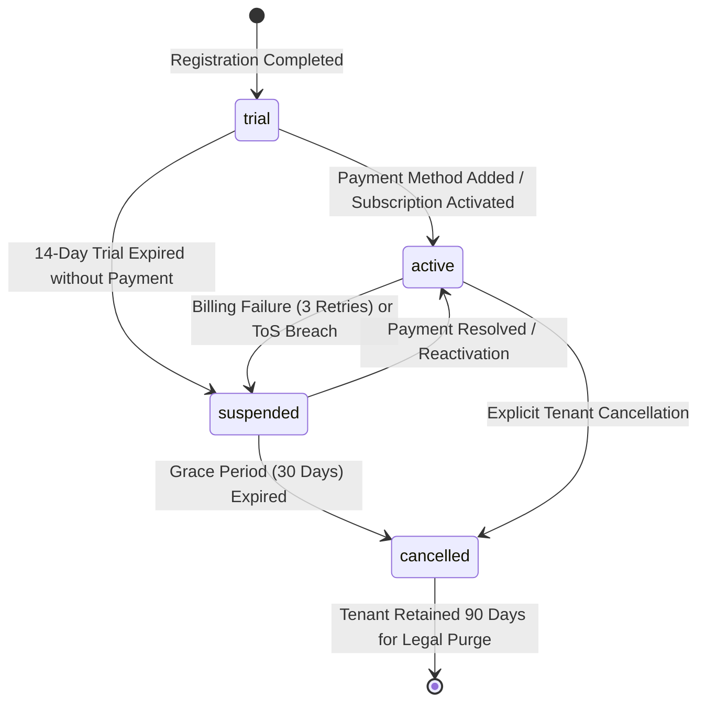
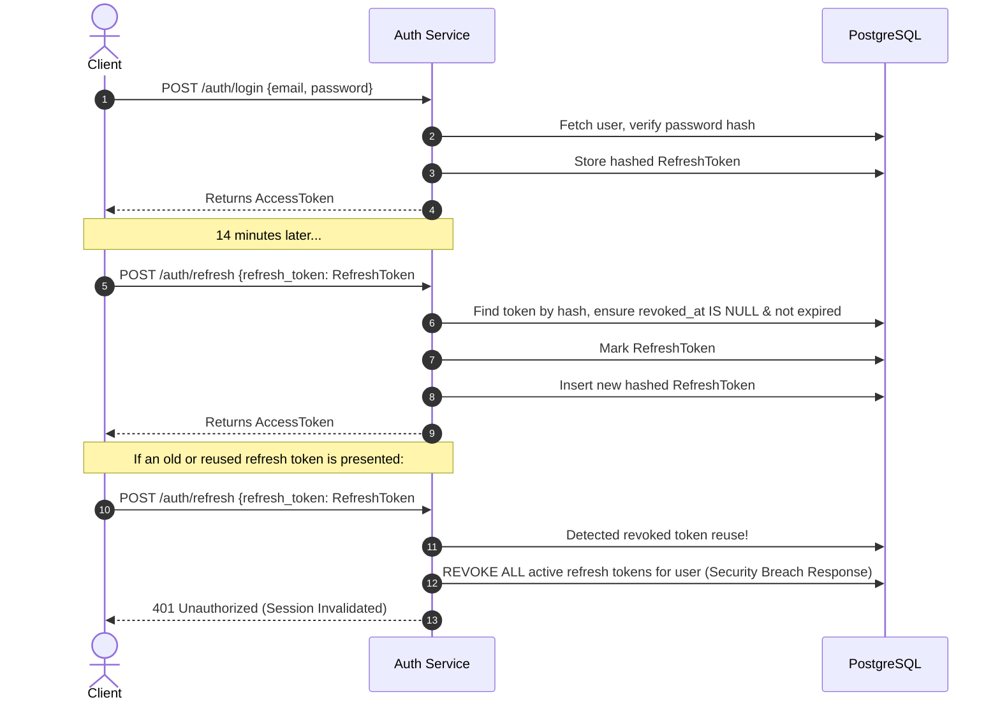
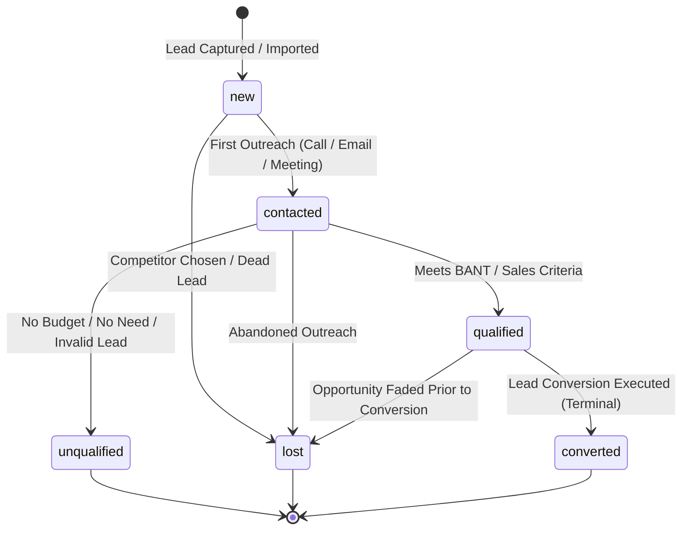
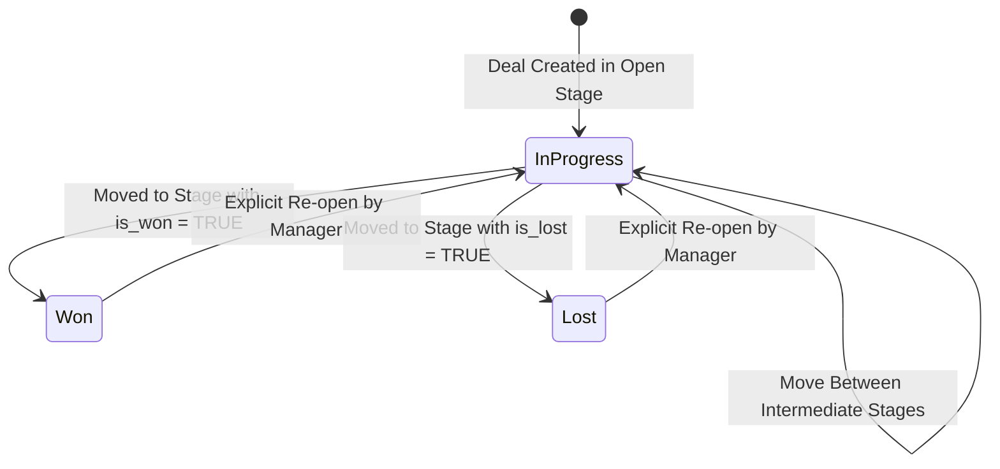
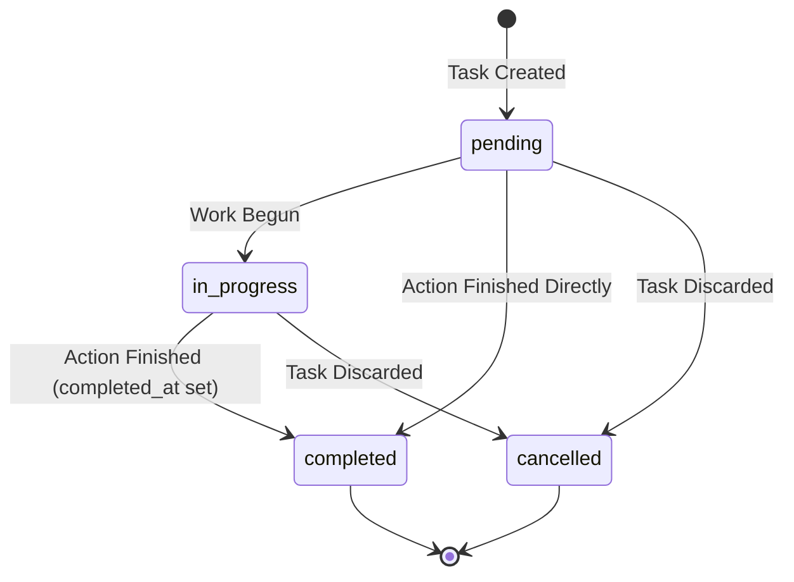
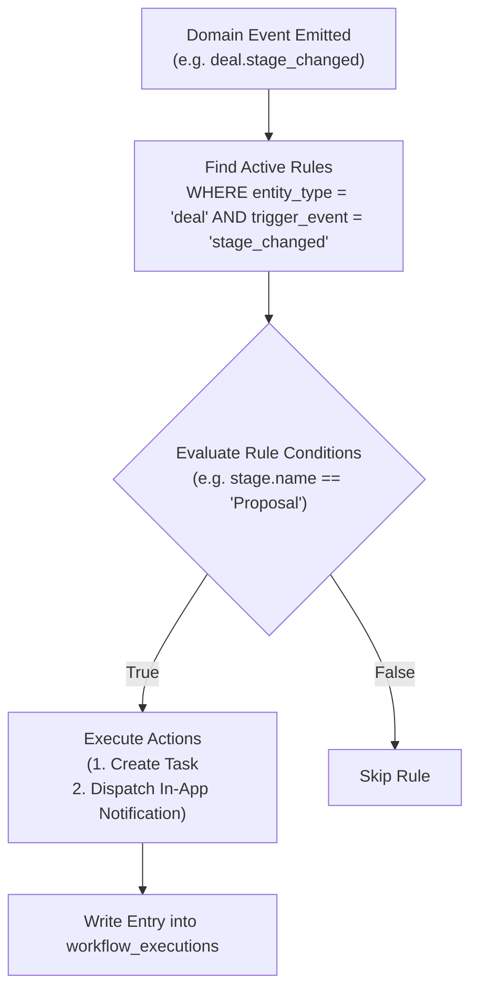

# NexCRM — Business Logic, Domain Workflows & Policy Specification

**Document Version:** 1.0.0  
**Status:** Approved Specification  
**Domain Layer:** FastAPI Domain Services & Transaction Orchestration

---

## 1. Organization & Tenant Lifecycle

### 1.1 Lifecycle State Machine



### 1.2 Tenant Onboarding Rules
When an organization registers via `POST /api/v1/auth/register`:
1. **Uniqueness Verification:** Organization `slug` must be globally unique across all platform tenants.
2. **Initial Admin Creation:** The registering user is created with `is_active = TRUE` and granted the system `org_admin` role.
3. **Default Seed Data Creation:**
   - Default Pipeline: `"Sales Pipeline"` is created with standard stages:
     1. `Qualification` (Position: 1, Probability: 10%)
     2. `Discovery & Demo` (Position: 2, Probability: 25%)
     3. `Proposal Sent` (Position: 3, Probability: 50%)
     4. `Negotiation` (Position: 4, Probability: 75%)
     5. `Closed Won` (Position: 5, Probability: 100%, `is_won = TRUE`)
     6. `Closed Lost` (Position: 6, Probability: 0%, `is_lost = TRUE`)
   - Default Tags: `"High Priority"`, `"VIP"`, `"Needs Follow-Up"`.
4. **Trial Initialization:** Sets `status = 'trial'` with trial expiration timestamp set to `CURRENT_TIMESTAMP + INTERVAL '14 days'`.

---

## 2. Authentication & User Security Policy

### 2.1 Password Requirements
- Minimum length: 10 characters.
- Must contain at least one uppercase letter (`[A-Z]`).
- Must contain at least one lowercase letter (`[a-z]`).
- Must contain at least one numeric digit (`[0-9]`).
- Must contain at least one special symbol (`[!@#$%^&*()_+\-=\[\]{}|;:,.<>?]`).
- Hashed using **Argon2id** (memory cost: 65,536 KiB, time cost: 3 iterations, parallelism: 4).

### 2.2 Account Lockout Policy
- 5 consecutive failed login attempts within a 15-minute window locks the account for 15 minutes (`locked_until = CURRENT_TIMESTAMP + INTERVAL '15 minutes'`).
- Successful login resets `failed_login_attempts = 0` and clears `locked_until`.

### 2.3 Token Security & Rotation Lifecycle


---

## 3. Role-Based Access Control (RBAC) & Ownership Rules

### 3.1 System Roles vs. Custom Roles
- **System Roles (`is_system_role = TRUE`):** Predefined, unmodifiable, un-deletable.
  - `super_admin`: Platform level (multi-tenant administration).
  - `org_admin`: Full administrative control over own tenant organization.
  - `sales_manager`: Can inspect, reassign, and manage all team leads, contacts, deals, tasks, and analytics within tenant.
  - `sales_rep`: Scoped to records owned by themselves (`owner_id == user.id`).
- **Custom Roles:** Created by tenant `org_admin`, assigned custom combinations of permissions.

### 3.2 Granular Permission Matrix

| Resource | Action | Super Admin | Org Admin | Sales Manager | Sales Rep |
|---|---|:---:|:---:|:---:|:---:|
| `organization` | `view`, `update` | ✓ | ✓ | View Only | View Only |
| `users` | `view`, `invite`, `update`, `deactivate` | ✓ | ✓ | View Only | View Own |
| `roles` | `view`, `create`, `update`, `delete` | ✓ | ✓ | ✗ | ✗ |
| `leads` | `view`, `create`, `update`, `delete` | ✓ | ✓ | ✓ | Own Only |
| `leads` | `assign`, `convert`, `import` | ✓ | ✓ | ✓ | Own Only |
| `contacts` | `view`, `create`, `update`, `delete` | ✓ | ✓ | ✓ | Own + Team |
| `companies` | `view`, `create`, `update`, `delete` | ✓ | ✓ | ✓ | Own + Team |
| `deals` | `view`, `create`, `update`, `delete` | ✓ | ✓ | ✓ | Own Only |
| `deals` | `change_stage`, `assign` | ✓ | ✓ | ✓ | Own Only |
| `pipelines` | `create`, `update`, `delete`, `reorder` | ✓ | ✓ | View Only | View Only |
| `activities` | `view`, `create`, `update`, `delete` | ✓ | ✓ | ✓ | Own Only |
| `tasks` | `view`, `create`, `update`, `complete` | ✓ | ✓ | ✓ | Own + Assigned |
| `reports` | `view_dashboard`, `view_sales`, `export`| ✓ | ✓ | ✓ | Own Metrics |
| `workflows` | `view`, `create`, `update`, `toggle` | ✓ | ✓ | ✗ | ✗ |
| `audit_logs` | `view` | ✓ | ✓ | ✗ | ✗ |

### 3.3 Record-Level Authorization Enforcement
For endpoints accessing specific records (e.g. `PATCH /api/v1/leads/{id}`), the authorization evaluation executes:
1. If user has `leads:update_all` -> **Permit**.
2. If user has `leads:update_own`:
   - Inspect entity: `record.owner_id == current_user.id`.
   - If true -> **Permit**; else -> **Deny with `403 Forbidden`**.
3. If neither -> **Deny with `403 Forbidden`**.

---

## 4. Lead Management & Qualification Lifecycle

### 4.1 Lead Status State Machine



### 4.2 Lead Business Rules
1. **Creation Defaults:** Newly created leads receive `status = 'new'`, `priority = 'medium'`, and `score = 0`.
2. **Auto-Assignment:** If `owner_id` is omitted in creation payload, it defaults to the creator's `user_id`.
3. **Duplicate Detection:** If an incoming lead shares an identical email with an existing active lead in the same organization, a warning flag is surfaced in response metadata (`duplicate_warning: true`), but creation is permitted.
4. **Qualification Score:** Can be manually updated (0–100) or incremented by activity completions (+10 for call connected, +15 for demo meeting scheduled).

---

## 5. Lead-to-Deal Conversion (The Core Business Workflow)

Lead conversion is the most critical workflow in the CRM. It transforms an uncommitted prospect into structured relational CRM records: a Contact, a Company, and a Deal.

### 5.1 Conversion Prerequisites
- Lead `status` must be `qualified` (or transitioning to qualified).
- Lead must not have been previously converted (`converted_at IS NULL` and `status != 'converted'`).
- The user must possess the `leads:convert` permission.

### 5.2 Transactional Execution Blueprint

```python
async with db_session.begin():
    # 1. Lock lead record for update to prevent race conditions
    lead = await lead_repo.get_for_update(lead_id, org_id)
    if lead.status == "converted":
        raise ConflictException("Lead has already been converted.")

    # 2. Handle Contact Creation / Association
    if conversion_data.create_contact:
        contact = await contact_repo.create(
            organization_id=org_id,
            first_name=conversion_data.contact.first_name or lead.first_name,
            last_name=conversion_data.contact.last_name or lead.last_name,
            email=conversion_data.contact.email or lead.email,
            phone=conversion_data.contact.phone or lead.phone,
            owner_id=lead.owner_id,
            lifecycle_stage="lead",
            created_by=current_user.id
        )
    elif conversion_data.existing_contact_id:
        contact = await contact_repo.get(conversion_data.existing_contact_id, org_id)

    # 3. Handle Company Creation / Association
    company = None
    if conversion_data.create_company:
        company = await company_repo.create(
            organization_id=org_id,
            name=conversion_data.company.name or lead.company_name,
            website=conversion_data.company.website or lead.website,
            owner_id=lead.owner_id,
            created_by=current_user.id
        )
        if contact:
            contact.company_id = company.id

    # 4. Handle Deal Creation
    deal = None
    if conversion_data.create_deal:
        deal = await deal_repo.create(
            organization_id=org_id,
            title=conversion_data.deal.title,
            amount=conversion_data.deal.amount,
            pipeline_id=conversion_data.deal.pipeline_id,
            stage_id=conversion_data.deal.stage_id,
            expected_close_date=conversion_data.deal.expected_close_date,
            owner_id=lead.owner_id,
            contact_id=contact.id if contact else None,
            company_id=company.id if company else None,
            created_by=current_user.id
        )

    # 5. Transition Lead to Terminal Converted State
    lead.status = "converted"
    lead.converted_at = datetime.now(timezone.utc)
    lead.converted_contact_id = contact.id if contact else None
    lead.converted_company_id = company.id if company else None
    lead.converted_deal_id = deal.id if deal else None
    lead.updated_by = current_user.id

    # 6. Relink Historical Activities to newly created Contact/Deal
    await activity_repo.relink_polymorphic(
        from_type="lead",
        from_id=lead.id,
        to_type="contact",
        to_id=contact.id
    )

    # 7. Write Audit Trail
    await audit_repo.create(
        organization_id=org_id,
        user_id=current_user.id,
        action="lead.converted",
        entity_type="lead",
        entity_id=lead.id,
        new_values={
            "contact_id": str(contact.id) if contact else None,
            "company_id": str(company.id) if company else None,
            "deal_id": str(deal.id) if deal else None
        }
    )
```

### 5.3 Idempotency & Post-Conversion Rules
- Once converted, a lead becomes strictly **read-only**. Any subsequent `PATCH`, `DELETE`, or `POST /convert` requests return `400 Bad Request` (`LEAD_ALREADY_CONVERTED`).
- If any sub-operation (e.g. invalid pipeline stage ID or database constraint violation) raises an exception, the entire transaction rolls back atomically. Zero orphan contacts or companies are created.

---

## 6. Deal Lifecycle & Pipeline Progression

### 6.1 Deal State & Stage Transition Rules



### 6.2 Deal Business Logic Rules
1. **Weighted Pipeline Value:**
   $$\text{Weighted Value} = \text{amount} \times \left(\frac{\text{stage.probability}}{100.0}\right)$$
2. **Transitioning to Won:**
   - When dropped onto a stage with `is_won = TRUE`:
     - `probability` is set to `100.00%`.
     - `actual_close_date` is set to `CURRENT_DATE`.
     - Emits trigger for `deal.won` notification to sales managers.
3. **Transitioning to Lost:**
   - When dropped onto a stage with `is_lost = TRUE`:
     - `probability` is set to `0.00%`.
     - `lost_reason` is **mandatory**; if omitted, the API rejects the transition with `422 Unprocessable Entity`.
     - `actual_close_date` is set to `CURRENT_DATE`.
4. **Reopening Closed Deals:**
   - Standard sales reps cannot move a deal out of `Won` or `Lost`. Only `sales_manager` or `org_admin` can reopen closed opportunities.

---

## 7. Productivity: Activities & Task Management

### 7.1 Polymorphic Entity Associations
Activities, notes, tasks, and attachments connect to parent CRM entities via:
- `related_entity_type`: `'lead' | 'contact' | 'company' | 'deal'`
- `related_entity_id`: `UUID`

The application verifies that the target referenced entity exists in the same tenant organization before committing the record.

### 7.2 Task Lifecycle & Automated Overdue Flagging



- **Overdue Condition:** A task is considered overdue when `due_date < CURRENT_DATE` and `status NOT IN ('completed', 'cancelled')`.
- Overdue tasks trigger a priority escalation alert to the assignee.

---

## 8. Automation Engine: Triggers, Conditions & Actions

The automation service listens for domain events and evaluates rules sequentially:



### Supported Actions
1. `create_task`: Injects a follow-up task with relative due dates (e.g. `due_in_days: 3`).
2. `send_notification`: Sends in-app alert to owner, manager, or specific role.
3. `update_field`: Mutates a record attribute (e.g. updates lead score by +20).

---

## 9. Soft Deletion & Cascade Policy

To protect organizations from inadvertent data loss:
1. **Core Entities:** `leads`, `contacts`, `companies`, `deals`, `tasks`, and `activities` use soft deletion (`deleted_at IS NOT NULL`).
2. **Cascade Behavior:** Soft-deleting a `company` does **NOT** cascade delete child `contacts` or `deals`. Instead, child records retain their `company_id`, but display visual tags indicating the parent account has been archived.
3. **Hard Deletion Guard:** Hard `DELETE` operations are barred from standard user endpoints. Only platform background maintenance or Super Admins can issue permanent purges.
