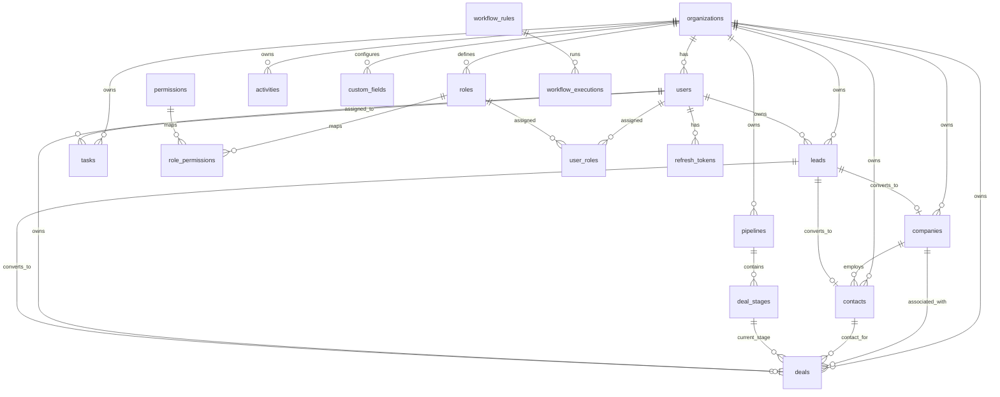

# NexCRM — Complete Database Schema & Persistence Design

**Document Version:** 1.0.0  
**Status:** Approved Technical Specification  
**Target Engine:** PostgreSQL 16+ with Alembic Migrations

---

## 1. Database Conventions & Standards

All database tables, columns, indexes, and constraints in NexCRM follow strict architectural standards:

1. **Primary Keys:** `UUIDv7` for all entity tables. This guarantees cryptographic unpredictability while retaining timestamp ordering, preventing B-Tree index fragmentation common to UUIDv4.
2. **Tenant Scoping:** Every tenant-owned table MUST declare `organization_id UUID NOT NULL REFERENCES organizations(id) ON DELETE CASCADE`.
3. **Naming Conventions:**
   - Tables: `snake_case`, pluralized (e.g., `deal_stages`, `audit_logs`).
   - Columns: `snake_case`, singularized (e.g., `expected_close_date`, `is_active`).
   - Foreign Keys: `<singular_table_name>_id` (e.g., `company_id`, `stage_id`).
   - Constraints: `pk_<table_name>`, `fk_<table>_<referenced_table>_<col>`, `uq_<table>_<cols>`, `ck_<table>_<name>`, `idx_<table>_<cols>`.
4. **Standard Audit Mixin Columns:**
   - `created_at TIMESTAMPTZ NOT NULL DEFAULT CURRENT_TIMESTAMP`
   - `updated_at TIMESTAMPTZ NOT NULL DEFAULT CURRENT_TIMESTAMP`
   - `created_by UUID REFERENCES users(id) ON DELETE SET NULL`
   - `updated_by UUID REFERENCES users(id) ON DELETE SET NULL`
   - `deleted_at TIMESTAMPTZ NULL` (for soft-deleted business records)
5. **Monetary & Numeric Fields:** All monetary values use `NUMERIC(15, 2)` to avoid floating-point inaccuracies. Percentages use `NUMERIC(5, 2)`.
6. **Timezone Representation:** All timestamps use `TIMESTAMPTZ` (UTC).

---

## 2. Entity Relationship Diagram (ERD)



---

## 3. Comprehensive Table Specifications

### A. Platform & Tenancy

#### 1. `organizations`
Stores tenant profiles and subscription states.

| Column | Data Type | Nullable | Default | Constraints & Description |
|---|---|---|---|---|
| `id` | UUID | NO | gen_random_uuid() | Primary Key (UUIDv7) |
| `name` | VARCHAR(255) | NO | - | Organization commercial name |
| `slug` | VARCHAR(100) | NO | - | Unique sub-path identifier (e.g. `acme-corp`) |
| `domain` | VARCHAR(255) | YES | NULL | Primary corporate email domain |
| `logo_url` | VARCHAR(1024)| YES | NULL | Storage key or URL to logo asset |
| `status` | VARCHAR(50)  | NO | 'trial' | CHECK (`status` IN ('trial', 'active', 'suspended', 'cancelled')) |
| `plan` | VARCHAR(50)  | NO | 'starter' | CHECK (`plan` IN ('free', 'starter', 'professional', 'enterprise')) |
| `settings` | JSONB | NO | '{}' | Custom tenant settings, timezone, currency |
| `created_at` | TIMESTAMPTZ | NO | CURRENT_TIMESTAMP | Audit timestamp |
| `updated_at` | TIMESTAMPTZ | NO | CURRENT_TIMESTAMP | Audit timestamp |

- **Constraints:** `CONSTRAINT uq_organizations_slug UNIQUE (slug)`

#### 2. `invitations`
Pending team member invitations.

| Column | Data Type | Nullable | Default | Constraints & Description |
|---|---|---|---|---|
| `id` | UUID | NO | gen_random_uuid() | Primary Key |
| `organization_id` | UUID | NO | - | FK -> `organizations(id)` ON DELETE CASCADE |
| `email` | VARCHAR(255) | NO | - | Invited user email address |
| `role_id` | UUID | NO | - | FK -> `roles(id)` ON DELETE RESTRICT |
| `invited_by` | UUID | NO | - | FK -> `users(id)` ON DELETE CASCADE |
| `token_hash` | VARCHAR(64) | NO | - | SHA-256 hash of single-use invitation token |
| `status` | VARCHAR(50) | NO | 'pending' | CHECK (`status` IN ('pending', 'accepted', 'expired', 'revoked')) |
| `expires_at` | TIMESTAMPTZ | NO | - | 72 hours from generation |
| `accepted_at` | TIMESTAMPTZ | YES | NULL | Timestamp when invitation was completed |
| `created_at` | TIMESTAMPTZ | NO | CURRENT_TIMESTAMP | Created timestamp |

- **Constraints:** `CONSTRAINT uq_invitations_token_hash UNIQUE (token_hash)`

---

### B. Authentication & Authorization (RBAC)

#### 3. `users`
Tenant members and administrators.

| Column | Data Type | Nullable | Default | Constraints & Description |
|---|---|---|---|---|
| `id` | UUID | NO | gen_random_uuid() | Primary Key |
| `organization_id` | UUID | NO | - | FK -> `organizations(id)` ON DELETE CASCADE |
| `email` | VARCHAR(255) | NO | - | Work email address |
| `password_hash` | VARCHAR(255) | NO | - | Argon2id password hash |
| `first_name` | VARCHAR(100) | NO | - | Given name |
| `last_name` | VARCHAR(100) | NO | - | Surname |
| `phone` | VARCHAR(50) | YES | NULL | Phone number |
| `avatar_url` | VARCHAR(1024)| YES | NULL | Storage key for profile image |
| `is_active` | BOOLEAN | NO | TRUE | Active status flag |
| `is_email_verified`| BOOLEAN | NO | FALSE | Verification status |
| `failed_login_attempts` | INT | NO | 0 | Brute force defense counter |
| `locked_until` | TIMESTAMPTZ | YES | NULL | Account lockout timestamp |
| `last_login_at` | TIMESTAMPTZ | YES | NULL | Last authenticated session |
| `created_at` | TIMESTAMPTZ | NO | CURRENT_TIMESTAMP | Audit timestamp |
| `updated_at` | TIMESTAMPTZ | NO | CURRENT_TIMESTAMP | Audit timestamp |
| `deleted_at` | TIMESTAMPTZ | YES | NULL | Soft deletion flag |

- **Constraints:** `CONSTRAINT uq_users_org_email UNIQUE (organization_id, email)`

#### 4. `roles`
System and custom tenant roles.

| Column | Data Type | Nullable | Default | Constraints & Description |
|---|---|---|---|---|
| `id` | UUID | NO | gen_random_uuid() | Primary Key |
| `organization_id` | UUID | YES | NULL | FK -> `organizations(id)` (NULL for global system roles) |
| `name` | VARCHAR(100) | NO | - | Role display name |
| `slug` | VARCHAR(100) | NO | - | Role identifier: `super_admin`, `org_admin`, `sales_manager`, `sales_rep` |
| `description` | TEXT | YES | NULL | Role description |
| `is_system_role` | BOOLEAN | NO | FALSE | System roles cannot be altered or deleted |
| `created_at` | TIMESTAMPTZ | NO | CURRENT_TIMESTAMP | Audit timestamp |
| `updated_at` | TIMESTAMPTZ | NO | CURRENT_TIMESTAMP | Audit timestamp |

- **Constraints:** `CONSTRAINT uq_roles_org_slug UNIQUE (organization_id, slug)`

#### 5. `permissions`
Global platform permissions matrix.

| Column | Data Type | Nullable | Default | Constraints & Description |
|---|---|---|---|---|
| `id` | UUID | NO | gen_random_uuid() | Primary Key |
| `resource` | VARCHAR(50) | NO | - | e.g. `leads`, `deals`, `contacts`, `users`, `reports` |
| `action` | VARCHAR(50) | NO | - | e.g. `read`, `create`, `update`, `delete`, `convert`, `export` |
| `description` | VARCHAR(255)| NO | - | Human readable explanation |

- **Constraints:** `CONSTRAINT uq_permissions_resource_action UNIQUE (resource, action)`

#### 6. `role_permissions`
Cross-table mapping roles to granted permissions.

| Column | Data Type | Nullable | Constraints |
|---|---|---|---|
| `role_id` | UUID | NO | FK -> `roles(id)` ON DELETE CASCADE |
| `permission_id` | UUID | NO | FK -> `permissions(id)` ON DELETE CASCADE |

- **Primary Key:** `(role_id, permission_id)`

#### 7. `user_roles`
User membership across assigned roles.

| Column | Data Type | Nullable | Constraints |
|---|---|---|---|
| `user_id` | UUID | NO | FK -> `users(id)` ON DELETE CASCADE |
| `role_id` | UUID | NO | FK -> `roles(id)` ON DELETE CASCADE |

- **Primary Key:** `(user_id, role_id)`

#### 8. `refresh_tokens`
Long-lived session tokens with rotation.

| Column | Data Type | Nullable | Default | Constraints & Description |
|---|---|---|---|---|
| `id` | UUID | NO | gen_random_uuid() | Primary Key |
| `user_id` | UUID | NO | - | FK -> `users(id)` ON DELETE CASCADE |
| `token_hash` | VARCHAR(64) | NO | - | SHA-256 hash of refresh token |
| `expires_at` | TIMESTAMPTZ | NO | - | Expiration timestamp (7 days) |
| `revoked_at` | TIMESTAMPTZ | YES | NULL | Revocation timestamp |
| `created_at` | TIMESTAMPTZ | NO | CURRENT_TIMESTAMP | Creation timestamp |

- **Constraints:** `CONSTRAINT uq_refresh_tokens_hash UNIQUE (token_hash)`

---

### C. CRM Core Domain Tables

#### 9. `companies`
Business accounts and prospective client organizations.

| Column | Data Type | Nullable | Default | Constraints & Description |
|---|---|---|---|---|
| `id` | UUID | NO | gen_random_uuid() | Primary Key |
| `organization_id` | UUID | NO | - | FK -> `organizations(id)` ON DELETE CASCADE |
| `name` | VARCHAR(255) | NO | - | Legal/Trade company name |
| `website` | VARCHAR(255) | YES | NULL | Company website URL |
| `industry` | VARCHAR(100) | YES | NULL | Sector/Industry |
| `employee_count_range` | VARCHAR(50)| YES | NULL | e.g. '1-10', '11-50', '51-200', '201-1000', '1000+' |
| `annual_revenue` | NUMERIC(15,2)| YES | NULL | Estimated annual revenue |
| `phone` | VARCHAR(50) | YES | NULL | Corporate phone number |
| `email` | VARCHAR(255) | YES | NULL | Generic corporate email address |
| `address_line1` | VARCHAR(255) | YES | NULL | Street address |
| `address_line2` | VARCHAR(255) | YES | NULL | Suite, floor, unit |
| `city` | VARCHAR(100) | YES | NULL | City |
| `state` | VARCHAR(100) | YES | NULL | State or province |
| `postal_code` | VARCHAR(30)  | YES | NULL | Postal/ZIP code |
| `country` | VARCHAR(100) | YES | NULL | Country |
| `description` | TEXT | YES | NULL | Company overview |
| `owner_id` | UUID | YES | NULL | FK -> `users(id)` ON DELETE SET NULL |
| `created_at` | TIMESTAMPTZ | NO | CURRENT_TIMESTAMP | Audit timestamp |
| `updated_at` | TIMESTAMPTZ | NO | CURRENT_TIMESTAMP | Audit timestamp |
| `created_by` | UUID | YES | NULL | FK -> `users(id)` ON DELETE SET NULL |
| `updated_by` | UUID | YES | NULL | FK -> `users(id)` ON DELETE SET NULL |
| `deleted_at` | TIMESTAMPTZ | YES | NULL | Soft deletion timestamp |

#### 10. `contacts`
Individual customer contacts and business counterparts.

| Column | Data Type | Nullable | Default | Constraints & Description |
|---|---|---|---|---|
| `id` | UUID | NO | gen_random_uuid() | Primary Key |
| `organization_id` | UUID | NO | - | FK -> `organizations(id)` ON DELETE CASCADE |
| `company_id` | UUID | YES | NULL | FK -> `companies(id)` ON DELETE SET NULL |
| `first_name` | VARCHAR(100) | NO | - | Contact given name |
| `last_name` | VARCHAR(100) | NO | - | Contact surname |
| `email` | VARCHAR(255) | YES | NULL | Primary contact email |
| `phone` | VARCHAR(50) | YES | NULL | Direct desk phone |
| `mobile` | VARCHAR(50) | YES | NULL | Mobile/cell phone |
| `title` | VARCHAR(100) | YES | NULL | Job title |
| `department` | VARCHAR(100) | YES | NULL | Organizational department |
| `lifecycle_stage`| VARCHAR(50) | NO | 'lead' | CHECK (`lifecycle_stage` IN ('lead', 'subscriber', 'customer', 'champion', 'other')) |
| `owner_id` | UUID | YES | NULL | FK -> `users(id)` ON DELETE SET NULL |
| `address_line1` | VARCHAR(255) | YES | NULL | Street address |
| `city` | VARCHAR(100) | YES | NULL | City |
| `state` | VARCHAR(100) | YES | NULL | State |
| `postal_code` | VARCHAR(30)  | YES | NULL | Postal code |
| `country` | VARCHAR(100) | YES | NULL | Country |
| `notes` | TEXT | YES | NULL | General background notes |
| `created_at` | TIMESTAMPTZ | NO | CURRENT_TIMESTAMP | Audit timestamp |
| `updated_at` | TIMESTAMPTZ | NO | CURRENT_TIMESTAMP | Audit timestamp |
| `created_by` | UUID | YES | NULL | FK -> `users(id)` ON DELETE SET NULL |
| `updated_by` | UUID | YES | NULL | FK -> `users(id)` ON DELETE SET NULL |
| `deleted_at` | TIMESTAMPTZ | YES | NULL | Soft deletion timestamp |

- **Constraints:** `CONSTRAINT uq_contacts_org_email UNIQUE (organization_id, email)` (enforced where `email IS NOT NULL AND deleted_at IS NULL`)

#### 11. `leads`
Prospects undergoing qualification before conversion.

| Column | Data Type | Nullable | Default | Constraints & Description |
|---|---|---|---|---|
| `id` | UUID | NO | gen_random_uuid() | Primary Key |
| `organization_id` | UUID | NO | - | FK -> `organizations(id)` ON DELETE CASCADE |
| `first_name` | VARCHAR(100) | NO | - | Lead first name |
| `last_name` | VARCHAR(100) | NO | - | Lead surname |
| `email` | VARCHAR(255) | YES | NULL | Lead email address |
| `phone` | VARCHAR(50) | YES | NULL | Lead phone number |
| `company_name` | VARCHAR(255) | YES | NULL | Prospective company name |
| `title` | VARCHAR(100) | YES | NULL | Job title |
| `source` | VARCHAR(50) | NO | 'website' | CHECK (`source` IN ('website', 'referral', 'cold_call', 'advertisement', 'social_media', 'partner', 'event', 'other')) |
| `status` | VARCHAR(50) | NO | 'new' | CHECK (`status` IN ('new', 'contacted', 'qualified', 'unqualified', 'converted', 'lost')) |
| `priority` | VARCHAR(20) | NO | 'medium' | CHECK (`priority` IN ('low', 'medium', 'high', 'critical')) |
| `score` | INT | NO | 0 | Qualification score (0-100) |
| `owner_id` | UUID | YES | NULL | FK -> `users(id)` ON DELETE SET NULL |
| `converted_contact_id` | UUID | YES | NULL | FK -> `contacts(id)` ON DELETE SET NULL |
| `converted_company_id` | UUID | YES | NULL | FK -> `companies(id)` ON DELETE SET NULL |
| `converted_deal_id` | UUID | YES | NULL | FK -> `deals(id)` ON DELETE SET NULL |
| `converted_at` | TIMESTAMPTZ | YES | NULL | Timestamp when conversion occurred |
| `lost_reason` | TEXT | YES | NULL | Reason for disqualification/loss |
| `website` | VARCHAR(255) | YES | NULL | Lead website |
| `city` | VARCHAR(100) | YES | NULL | City |
| `country` | VARCHAR(100) | YES | NULL | Country |
| `notes` | TEXT | YES | NULL | Qualification notes |
| `created_at` | TIMESTAMPTZ | NO | CURRENT_TIMESTAMP | Audit timestamp |
| `updated_at` | TIMESTAMPTZ | NO | CURRENT_TIMESTAMP | Audit timestamp |
| `created_by` | UUID | YES | NULL | FK -> `users(id)` ON DELETE SET NULL |
| `updated_by` | UUID | YES | NULL | FK -> `users(id)` ON DELETE SET NULL |
| `deleted_at` | TIMESTAMPTZ | YES | NULL | Soft deletion timestamp |

---

### D. Sales Pipeline & Deal Management

#### 12. `pipelines`
Sales processes and tracks.

| Column | Data Type | Nullable | Default | Constraints & Description |
|---|---|---|---|---|
| `id` | UUID | NO | gen_random_uuid() | Primary Key |
| `organization_id` | UUID | NO | - | FK -> `organizations(id)` ON DELETE CASCADE |
| `name` | VARCHAR(100) | NO | - | e.g. "Direct Sales", "Enterprise SaaS" |
| `is_default` | BOOLEAN | NO | FALSE | Marks primary pipeline for new deals |
| `created_at` | TIMESTAMPTZ | NO | CURRENT_TIMESTAMP | Audit timestamp |
| `updated_at` | TIMESTAMPTZ | NO | CURRENT_TIMESTAMP | Audit timestamp |

#### 13. `deal_stages`
Sequential phases within a pipeline.

| Column | Data Type | Nullable | Default | Constraints & Description |
|---|---|---|---|---|
| `id` | UUID | NO | gen_random_uuid() | Primary Key |
| `pipeline_id` | UUID | NO | - | FK -> `pipelines(id)` ON DELETE CASCADE |
| `name` | VARCHAR(100) | NO | - | Stage name (e.g. "Proposal") |
| `position` | INT | NO | 0 | Display sequence ordering |
| `probability` | NUMERIC(5,2)| NO | 0.00 | Default win probability (0.00 to 100.00) |
| `is_won` | BOOLEAN | NO | FALSE | Stage represents closed-won state |
| `is_lost` | BOOLEAN | NO | FALSE | Stage represents closed-lost state |
| `created_at` | TIMESTAMPTZ | NO | CURRENT_TIMESTAMP | Audit timestamp |
| `updated_at` | TIMESTAMPTZ | NO | CURRENT_TIMESTAMP | Audit timestamp |

- **Constraints:** `CONSTRAINT ck_stages_won_lost CHECK (NOT (is_won = TRUE AND is_lost = TRUE))`

#### 14. `deals`
Revenue opportunities progressing across stages.

| Column | Data Type | Nullable | Default | Constraints & Description |
|---|---|---|---|---|
| `id` | UUID | NO | gen_random_uuid() | Primary Key |
| `organization_id` | UUID | NO | - | FK -> `organizations(id)` ON DELETE CASCADE |
| `title` | VARCHAR(255) | NO | - | Deal summary title |
| `amount` | NUMERIC(15,2)| NO | 0.00 | Monetary value of opportunity |
| `currency` | VARCHAR(3) | NO | 'USD' | ISO 4217 Currency Code |
| `pipeline_id` | UUID | NO | - | FK -> `pipelines(id)` ON DELETE RESTRICT |
| `stage_id` | UUID | NO | - | FK -> `deal_stages(id)` ON DELETE RESTRICT |
| `owner_id` | UUID | YES | NULL | FK -> `users(id)` ON DELETE SET NULL |
| `contact_id` | UUID | YES | NULL | FK -> `contacts(id)` ON DELETE SET NULL |
| `company_id` | UUID | YES | NULL | FK -> `companies(id)` ON DELETE SET NULL |
| `expected_close_date`| DATE | YES | NULL | Forecasted close date |
| `actual_close_date` | DATE | YES | NULL | Date deal transitioned to won/lost |
| `probability` | NUMERIC(5,2)| NO | 0.00 | Current deal probability percentage |
| `lost_reason` | TEXT | YES | NULL | Required if marked lost |
| `won_reason` | TEXT | YES | NULL | Notes on deal success |
| `created_at` | TIMESTAMPTZ | NO | CURRENT_TIMESTAMP | Audit timestamp |
| `updated_at` | TIMESTAMPTZ | NO | CURRENT_TIMESTAMP | Audit timestamp |
| `created_by` | UUID | YES | NULL | FK -> `users(id)` ON DELETE SET NULL |
| `updated_by` | UUID | YES | NULL | FK -> `users(id)` ON DELETE SET NULL |
| `deleted_at` | TIMESTAMPTZ | YES | NULL | Soft deletion timestamp |

---

### E. Activities, Tasks & Productivity

#### 15. `activities`
Polymorphic interaction logs (calls, meetings, notes, logged emails).

| Column | Data Type | Nullable | Default | Constraints & Description |
|---|---|---|---|---|
| `id` | UUID | NO | gen_random_uuid() | Primary Key |
| `organization_id` | UUID | NO | - | FK -> `organizations(id)` ON DELETE CASCADE |
| `type` | VARCHAR(50) | NO | - | CHECK (`type` IN ('call', 'email', 'meeting', 'note', 'task')) |
| `subject` | VARCHAR(255) | NO | - | Short activity summary |
| `description` | TEXT | YES | NULL | Comprehensive notes/details |
| `due_at` | TIMESTAMPTZ | YES | NULL | Scheduled start or target deadline |
| `completed_at` | TIMESTAMPTZ | YES | NULL | Completion timestamp |
| `duration_minutes` | INT | YES | NULL | Call or meeting duration |
| `outcome` | VARCHAR(100) | YES | NULL | Outcome (e.g. 'connected', 'busy', 'rescheduled') |
| `owner_id` | UUID | YES | NULL | FK -> `users(id)` ON DELETE SET NULL |
| `related_entity_type` | VARCHAR(50) | YES | NULL | Entity discriminator: `lead`, `contact`, `company`, `deal` |
| `related_entity_id` | UUID | YES | NULL | Primary key of associated entity |
| `location` | VARCHAR(255) | YES | NULL | Meeting location or conference URL |
| `is_completed` | BOOLEAN | NO | FALSE | Execution status flag |
| `created_at` | TIMESTAMPTZ | NO | CURRENT_TIMESTAMP | Audit timestamp |
| `updated_at` | TIMESTAMPTZ | NO | CURRENT_TIMESTAMP | Audit timestamp |
| `created_by` | UUID | YES | NULL | FK -> `users(id)` ON DELETE SET NULL |
| `updated_by` | UUID | YES | NULL | FK -> `users(id)` ON DELETE SET NULL |
| `deleted_at` | TIMESTAMPTZ | YES | NULL | Soft deletion timestamp |

#### 16. `tasks`
Assigned action items with deadlines and tracking.

| Column | Data Type | Nullable | Default | Constraints & Description |
|---|---|---|---|---|
| `id` | UUID | NO | gen_random_uuid() | Primary Key |
| `organization_id` | UUID | NO | - | FK -> `organizations(id)` ON DELETE CASCADE |
| `title` | VARCHAR(255) | NO | - | Actionable task name |
| `description` | TEXT | YES | NULL | Detailed instructions |
| `status` | VARCHAR(50) | NO | 'pending' | CHECK (`status` IN ('pending', 'in_progress', 'completed', 'cancelled')) |
| `priority` | VARCHAR(20) | NO | 'medium' | CHECK (`priority` IN ('low', 'medium', 'high', 'critical')) |
| `due_date` | DATE | YES | NULL | Scheduled target date |
| `completed_at` | TIMESTAMPTZ | YES | NULL | Timestamp of completion |
| `assigned_to` | UUID | YES | NULL | FK -> `users(id)` ON DELETE SET NULL |
| `related_entity_type` | VARCHAR(50) | YES | NULL | `lead`, `contact`, `company`, `deal` |
| `related_entity_id` | UUID | YES | NULL | Associated entity record ID |
| `created_at` | TIMESTAMPTZ | NO | CURRENT_TIMESTAMP | Audit timestamp |
| `updated_at` | TIMESTAMPTZ | NO | CURRENT_TIMESTAMP | Audit timestamp |
| `created_by` | UUID | YES | NULL | FK -> `users(id)` ON DELETE SET NULL |
| `updated_by` | UUID | YES | NULL | FK -> `users(id)` ON DELETE SET NULL |
| `deleted_at` | TIMESTAMPTZ | YES | NULL | Soft deletion timestamp |

#### 17. `notes`
Rich-text annotations attached to CRM records.

| Column | Data Type | Nullable | Default | Constraints & Description |
|---|---|---|---|---|
| `id` | UUID | NO | gen_random_uuid() | Primary Key |
| `organization_id` | UUID | NO | - | FK -> `organizations(id)` ON DELETE CASCADE |
| `content` | TEXT | NO | - | Note markdown or HTML content |
| `related_entity_type` | VARCHAR(50) | NO | - | `lead`, `contact`, `company`, `deal` |
| `related_entity_id` | UUID | NO | - | Associated entity ID |
| `is_pinned` | BOOLEAN | NO | FALSE | Displays pinned at the top of timeline |
| `created_at` | TIMESTAMPTZ | NO | CURRENT_TIMESTAMP | Creation timestamp |
| `updated_at` | TIMESTAMPTZ | NO | CURRENT_TIMESTAMP | Update timestamp |
| `created_by` | UUID | YES | NULL | FK -> `users(id)` ON DELETE SET NULL |

---

### F. Communication

#### 18. `email_messages`
Inbound/outbound email history and threading.

| Column | Data Type | Nullable | Default | Constraints & Description |
|---|---|---|---|---|
| `id` | UUID | NO | gen_random_uuid() | Primary Key |
| `organization_id` | UUID | NO | - | FK -> `organizations(id)` ON DELETE CASCADE |
| `from_address` | VARCHAR(255) | NO | - | Sender email address |
| `to_addresses` | JSONB | NO | '[]' | List of recipient emails |
| `cc_addresses` | JSONB | NO | '[]' | List of CC recipient emails |
| `subject` | VARCHAR(500) | NO | - | Email subject header |
| `body_text` | TEXT | YES | NULL | Plaintext email body |
| `body_html` | TEXT | YES | NULL | Sanitized HTML content |
| `direction` | VARCHAR(20) | NO | 'outbound' | CHECK (`direction` IN ('inbound', 'outbound')) |
| `status` | VARCHAR(20) | NO | 'sent' | CHECK (`status` IN ('draft', 'sent', 'delivered', 'failed', 'bounced')) |
| `sent_at` | TIMESTAMPTZ | YES | NULL | Dispatch timestamp |
| `related_entity_type` | VARCHAR(50) | YES | NULL | Associated entity type |
| `related_entity_id` | UUID | YES | NULL | Associated entity record ID |
| `thread_id` | VARCHAR(255) | YES | NULL | Email conversation thread reference |
| `message_id_header`| VARCHAR(500) | YES | NULL | Standard RFC 5322 Message-ID |
| `created_at` | TIMESTAMPTZ | NO | CURRENT_TIMESTAMP | Record created timestamp |
| `created_by` | UUID | YES | NULL | FK -> `users(id)` ON DELETE SET NULL |

---

### G. Supporting & Extensibility Systems

#### 19. `attachments`
Uploaded file storage metadata.

| Column | Data Type | Nullable | Default | Constraints & Description |
|---|---|---|---|---|
| `id` | UUID | NO | gen_random_uuid() | Primary Key |
| `organization_id` | UUID | NO | - | FK -> `organizations(id)` ON DELETE CASCADE |
| `file_name` | VARCHAR(255) | NO | - | Original uploaded filename |
| `file_size` | BIGINT | NO | - | Size in bytes |
| `content_type` | VARCHAR(100) | NO | - | MIME type (e.g. `application/pdf`) |
| `storage_key` | VARCHAR(1024)| NO | - | Local path or S3 object path key |
| `related_entity_type`| VARCHAR(50)| YES | NULL | Associated entity type |
| `related_entity_id`| UUID | YES | NULL | Associated entity ID |
| `uploaded_by` | UUID | YES | NULL | FK -> `users(id)` ON DELETE SET NULL |
| `created_at` | TIMESTAMPTZ | NO | CURRENT_TIMESTAMP | Upload timestamp |

#### 20. `tags` & `entity_tags`
Categorization labels across CRM records.

**`tags` Table:**
| Column | Data Type | Nullable | Constraints & Description |
|---|---|---|---|
| `id` | UUID | NO | Primary Key |
| `organization_id` | UUID | NO | FK -> `organizations(id)` ON DELETE CASCADE |
| `name` | VARCHAR(50) | NO | Tag label (e.g. 'High Priority') |
| `color` | VARCHAR(7) | NO | Hex color code (e.g. `#3B82F6`) |
| `created_at` | TIMESTAMPTZ | NO | DEFAULT CURRENT_TIMESTAMP |

- **Constraints:** `CONSTRAINT uq_tags_org_name UNIQUE (organization_id, name)`

**`entity_tags` Table:**
| Column | Data Type | Nullable | Constraints |
|---|---|---|---|
| `tag_id` | UUID | NO | FK -> `tags(id)` ON DELETE CASCADE |
| `entity_type` | VARCHAR(50) | NO | Entity discriminator |
| `entity_id` | UUID | NO | Entity record ID |

- **Primary Key:** `(tag_id, entity_type, entity_id)`

#### 21. `custom_fields` & `custom_field_values`
Organization-defined schema extensions.

**`custom_fields` Table:**
| Column | Data Type | Nullable | Constraints & Description |
|---|---|---|---|
| `id` | UUID | NO | Primary Key |
| `organization_id` | UUID | NO | FK -> `organizations(id)` ON DELETE CASCADE |
| `entity_type` | VARCHAR(50) | NO | e.g. `lead`, `contact`, `company`, `deal` |
| `field_name` | VARCHAR(50) | NO | Machine name (e.g. `vat_number`) |
| `field_label` | VARCHAR(100)| NO | Display label (e.g. 'VAT Number') |
| `field_type` | VARCHAR(30) | NO | CHECK (`field_type` IN ('text', 'number', 'date', 'select', 'multiselect', 'boolean', 'url', 'email', 'phone')) |
| `options` | JSONB | YES | Allowed choices for `select` or `multiselect` |
| `is_required` | BOOLEAN | NO | DEFAULT FALSE |
| `position` | INT | NO | Display sequence |
| `created_at` | TIMESTAMPTZ | NO | DEFAULT CURRENT_TIMESTAMP |
| `updated_at` | TIMESTAMPTZ | NO | DEFAULT CURRENT_TIMESTAMP |

- **Constraints:** `CONSTRAINT uq_custom_fields_org_entity_name UNIQUE (organization_id, entity_type, field_name)`

**`custom_field_values` Table:**
| Column | Data Type | Nullable | Constraints & Description |
|---|---|---|---|
| `id` | UUID | NO | Primary Key |
| `custom_field_id` | UUID | NO | FK -> `custom_fields(id)` ON DELETE CASCADE |
| `entity_id` | UUID | NO | Record ID receiving value |
| `entity_type` | VARCHAR(50) | NO | Denormalized entity type |
| `value_text` | TEXT | YES | For text, url, email, phone, select |
| `value_number` | NUMERIC(15,4)| YES | For numeric types |
| `value_date` | DATE | YES | For date types |
| `value_boolean` | BOOLEAN | YES | For boolean switches |
| `value_json` | JSONB | YES | For multiselect array storage |
| `created_at` | TIMESTAMPTZ | NO | DEFAULT CURRENT_TIMESTAMP |
| `updated_at` | TIMESTAMPTZ | NO | DEFAULT CURRENT_TIMESTAMP |

- **Constraints:** `CONSTRAINT uq_cf_values_field_entity UNIQUE (custom_field_id, entity_id)`

---

### H. Workflow Automation Engine

#### 22. `workflow_rules`
Tenant event-based automation triggers.

| Column | Data Type | Nullable | Default | Constraints & Description |
|---|---|---|---|---|
| `id` | UUID | NO | gen_random_uuid() | Primary Key |
| `organization_id` | UUID | NO | - | FK -> `organizations(id)` ON DELETE CASCADE |
| `name` | VARCHAR(255) | NO | - | Automation rule name |
| `description` | TEXT | YES | NULL | Rule purpose |
| `entity_type` | VARCHAR(50) | NO | - | Target entity: `lead`, `deal`, `contact`, `company` |
| `trigger_event` | VARCHAR(50) | NO | - | CHECK (`trigger_event` IN ('created', 'updated', 'field_changed', 'stage_changed')) |
| `conditions` | JSONB | NO | '[]' | JSON logic condition rules |
| `actions` | JSONB | NO | '[]' | Action payload definitions (e.g. create task, notify) |
| `is_active` | BOOLEAN | NO | TRUE | Rule activation flag |
| `execution_order`| INT | NO | 0 | Evaluation priority order |
| `created_at` | TIMESTAMPTZ | NO | CURRENT_TIMESTAMP | Audit timestamp |
| `updated_at` | TIMESTAMPTZ | NO | CURRENT_TIMESTAMP | Audit timestamp |
| `created_by` | UUID | YES | NULL | FK -> `users(id)` ON DELETE SET NULL |

#### 23. `workflow_executions`
Execution logs and diagnostics for workflow runs.

| Column | Data Type | Nullable | Default | Constraints & Description |
|---|---|---|---|---|
| `id` | UUID | NO | gen_random_uuid() | Primary Key |
| `workflow_rule_id` | UUID | NO | - | FK -> `workflow_rules(id)` ON DELETE CASCADE |
| `entity_type` | VARCHAR(50) | NO | - | Target entity type |
| `entity_id` | UUID | NO | - | Target record ID |
| `status` | VARCHAR(20) | NO | 'pending' | CHECK (`status` IN ('pending', 'running', 'completed', 'failed')) |
| `started_at` | TIMESTAMPTZ | NO | CURRENT_TIMESTAMP | Execution start |
| `completed_at` | TIMESTAMPTZ | YES | NULL | Execution completion |
| `error_message` | TEXT | YES | NULL | Diagnostic failure message |
| `execution_log` | JSONB | NO | '{}' | Step-by-step evaluation log |
| `created_at` | TIMESTAMPTZ | NO | CURRENT_TIMESTAMP | Record created timestamp |

---

### I. System & Audit Logging

#### 24. `notifications`
In-app alerts and notifications delivered to users.

| Column | Data Type | Nullable | Default | Constraints & Description |
|---|---|---|---|---|
| `id` | UUID | NO | gen_random_uuid() | Primary Key |
| `user_id` | UUID | NO | - | FK -> `users(id)` ON DELETE CASCADE |
| `organization_id` | UUID | NO | - | FK -> `organizations(id)` ON DELETE CASCADE |
| `title` | VARCHAR(255) | NO | - | Notification headline |
| `message` | TEXT | NO | - | Descriptive message |
| `type` | VARCHAR(50) | NO | 'info' | Category: `assignment`, `reminder`, `alert`, `system` |
| `is_read` | BOOLEAN | NO | FALSE | Read/unread flag |
| `related_entity_type`| VARCHAR(50)| YES | NULL | Associated entity type |
| `related_entity_id`| UUID | YES | NULL | Associated entity ID |
| `created_at` | TIMESTAMPTZ | NO | CURRENT_TIMESTAMP | Timestamp generated |
| `read_at` | TIMESTAMPTZ | YES | NULL | Timestamp read |

#### 25. `audit_logs`
Immutable compliance and business history trail.

| Column | Data Type | Nullable | Default | Constraints & Description |
|---|---|---|---|---|
| `id` | UUID | NO | gen_random_uuid() | Primary Key |
| `organization_id` | UUID | NO | - | FK -> `organizations(id)` ON DELETE CASCADE |
| `user_id` | UUID | YES | NULL | FK -> `users(id)` ON DELETE SET NULL |
| `action` | VARCHAR(100) | NO | - | e.g. `lead.converted`, `deal.stage_changed`, `user.login` |
| `entity_type` | VARCHAR(50) | NO | - | Affected table or model |
| `entity_id` | UUID | YES | NULL | Affected record primary key |
| `old_values` | JSONB | YES | NULL | State snapshot prior to change |
| `new_values` | JSONB | YES | NULL | State snapshot after change |
| `ip_address` | INET | YES | NULL | Client IP address |
| `user_agent` | TEXT | YES | NULL | Client browser/agent string |
| `created_at` | TIMESTAMPTZ | NO | CURRENT_TIMESTAMP | Immutable creation timestamp |

*(Note: `audit_logs` has no `updated_at` or `deleted_at`; records are permanent and append-only).*

---

## 4. Indexing & Query Optimization Strategy

### A. Tenant Isolation & Filtering Indexes
Every tenant-scoped table features an index on `organization_id`:
```sql
CREATE INDEX idx_users_org_id ON users(organization_id);
CREATE INDEX idx_leads_org_id ON leads(organization_id);
CREATE INDEX idx_contacts_org_id ON contacts(organization_id);
CREATE INDEX idx_companies_org_id ON companies(organization_id);
CREATE INDEX idx_deals_org_id ON deals(organization_id);
CREATE INDEX idx_activities_org_id ON activities(organization_id);
CREATE INDEX idx_tasks_org_id ON tasks(organization_id);
CREATE INDEX idx_audit_logs_org_id ON audit_logs(organization_id);
```

### B. Ownership & Assignment Indexes
```sql
CREATE INDEX idx_leads_org_owner ON leads(organization_id, owner_id) WHERE deleted_at IS NULL;
CREATE INDEX idx_deals_org_owner ON deals(organization_id, owner_id) WHERE deleted_at IS NULL;
CREATE INDEX idx_contacts_org_owner ON contacts(organization_id, owner_id) WHERE deleted_at IS NULL;
CREATE INDEX idx_companies_org_owner ON companies(organization_id, owner_id) WHERE deleted_at IS NULL;
CREATE INDEX idx_tasks_org_assigned ON tasks(organization_id, assigned_to) WHERE deleted_at IS NULL;
```

### C. Pipeline & Opportunity Indexes
```sql
CREATE INDEX idx_deals_stage ON deals(organization_id, stage_id) WHERE deleted_at IS NULL;
CREATE INDEX idx_deals_pipeline ON deals(organization_id, pipeline_id) WHERE deleted_at IS NULL;
CREATE INDEX idx_deals_close_date ON deals(organization_id, expected_close_date) WHERE deleted_at IS NULL;
```

### D. Polymorphic Association Indexes
```sql
CREATE INDEX idx_activities_polymorphic ON activities(organization_id, related_entity_type, related_entity_id);
CREATE INDEX idx_tasks_polymorphic ON tasks(organization_id, related_entity_type, related_entity_id);
CREATE INDEX idx_notes_polymorphic ON notes(organization_id, related_entity_type, related_entity_id);
CREATE INDEX idx_attachments_polymorphic ON attachments(organization_id, related_entity_type, related_entity_id);
```

### E. JSONB & Full-Text Search (FTS) Indexes
```sql
-- GIN indexing for workflow execution logs and organization configuration
CREATE INDEX idx_workflow_executions_log ON workflow_executions USING GIN (execution_log);
CREATE INDEX idx_audit_logs_new_vals ON audit_logs USING GIN (new_values);

-- Full-Text Search composite GIN indexes for fast CRM search
CREATE INDEX idx_leads_fts ON leads USING GIN (
    to_tsvector('english', coalesce(first_name, '') || ' ' || coalesce(last_name, '') || ' ' || coalesce(company_name, '') || ' ' || coalesce(email, ''))
);

CREATE INDEX idx_contacts_fts ON contacts USING GIN (
    to_tsvector('english', coalesce(first_name, '') || ' ' || coalesce(last_name, '') || ' ' || coalesce(email, ''))
);

CREATE INDEX idx_companies_fts ON companies USING GIN (
    to_tsvector('english', coalesce(name, '') || ' ' || coalesce(website, ''))
);
```

---

## 5. PostgreSQL Row-Level Security (RLS) Policies

As a defense-in-depth isolation boundary, NexCRM configures PostgreSQL RLS across all business tables. Even if application query logic fails to apply an `organization_id` filter, PostgreSQL denies access to rows belonging to other tenants.

```sql
-- 1. Enable RLS on core tables
ALTER TABLE leads ENABLE ROW LEVEL SECURITY;
ALTER TABLE contacts ENABLE ROW LEVEL SECURITY;
ALTER TABLE companies ENABLE ROW LEVEL SECURITY;
ALTER TABLE deals ENABLE ROW LEVEL SECURITY;
ALTER TABLE activities ENABLE ROW LEVEL SECURITY;
ALTER TABLE tasks ENABLE ROW LEVEL SECURITY;
ALTER TABLE notes ENABLE ROW LEVEL SECURITY;

-- 2. Define tenant isolation policy for leads
CREATE POLICY tenant_isolation_leads ON leads
    FOR ALL
    TO nexcrm_app
    USING (
        organization_id = NULLIF(current_setting('app.current_tenant', true), '')::uuid
    )
    WITH CHECK (
        organization_id = NULLIF(current_setting('app.current_tenant', true), '')::uuid
    );

-- 3. Define tenant isolation policy for deals
CREATE POLICY tenant_isolation_deals ON deals
    FOR ALL
    TO nexcrm_app
    USING (
        organization_id = NULLIF(current_setting('app.current_tenant', true), '')::uuid
    )
    WITH CHECK (
        organization_id = NULLIF(current_setting('app.current_tenant', true), '')::uuid
    );
```

When a database connection is borrowed from the async connection pool in FastAPI middleware:
```python
await db_session.execute(
    text("SET LOCAL app.current_tenant = :tenant_id"),
    {"tenant_id": str(current_user.organization_id)}
)
```

---

## 6. Alembic Migration Strategy

1. **Environment Configuration (`alembic/env.py`):**
   - Configured with `asyncio` support using `async_engine_from_config`.
   - Discovers all declarative models via `from app.models.base import Base`.
   - `compare_type=True` and `compare_server_default=True` enabled in `context.configure()` for accurate schema diffs.
2. **Revision Naming Protocol:**
   `YYYYMMDD_HHMM_<descriptive_snake_case_name>.py` (e.g. `20261101_1000_create_leads_and_deals.py`).
3. **Migration Rules:**
   - Every migration script must define both `upgrade()` and fully reversible `downgrade()` procedures.
   - Irreversible data drops require explicit exceptions in `downgrade()`.
   - Schema migrations and large data transformations run in separate revision scripts.
