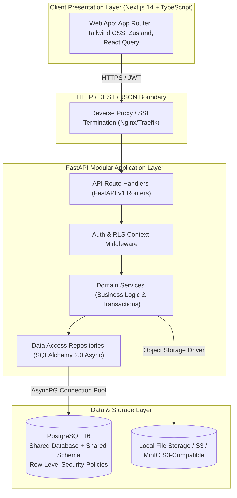
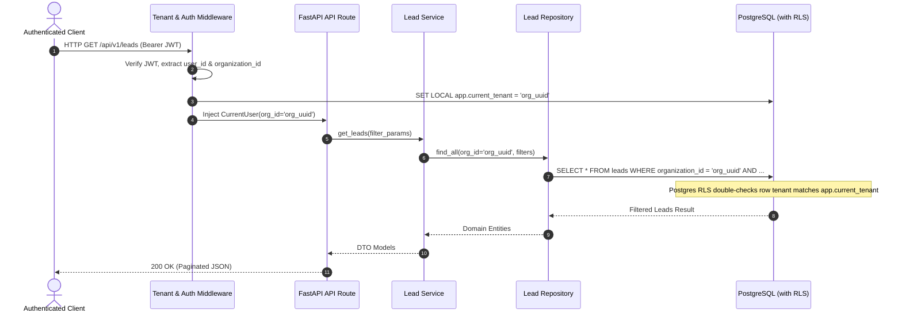
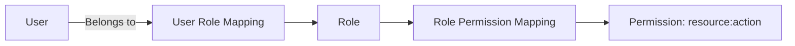
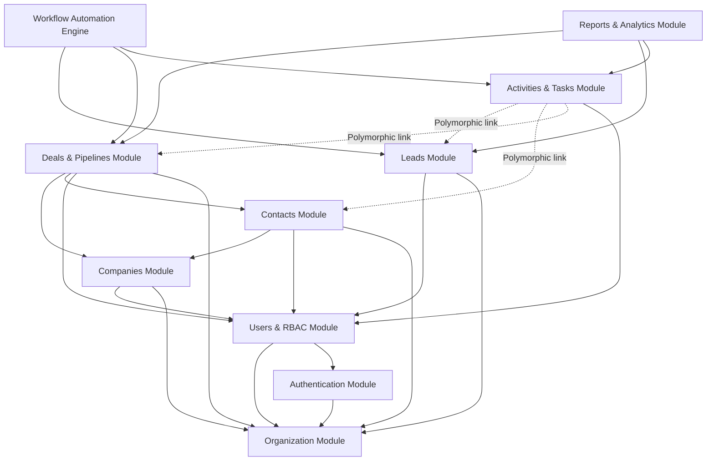

# NexCRM — System Architecture & Technical Design Document

**Document Version:** 1.0.0  
**Status:** Approved Architecture Draft  
**Target Architecture:** Modular Monolith (FastAPI + PostgreSQL + Next.js)

---

## 1. Executive Summary

**NexCRM** is a modern, high-performance, multi-tenant Software-as-a-Service (SaaS) Customer Relationship Management (CRM) platform. It allows multiple organizations (tenants) to manage sales pipelines, customer interactions, lead qualification, communication activities, and automated workflows in an isolated, secure, and compliant environment.

### Target Personas & Roles
1. **Super Admin (Platform Level):** Manages organizations, subscriptions, tenant status, platform-wide metrics.
2. **Organization Admin (Tenant Admin):** Manages users, security policies, role assignments, custom fields, and organization-level defaults.
3. **Sales Manager:** Manages sales teams, inspects pipelines, reallocates leads/deals, reviews forecasts and team performance.
4. **Sales Representative:** Handles day-to-day interactions, qualifies leads, runs deals across pipelines, records tasks, calls, and meetings.

### Core Value Proposition
- **High Developer Velocity without Microservice Chaos:** Clean domain isolation inside a modular monolith.
- **Strict Multi-Tenancy:** Hard boundary enforcement using shared database + shared schema with PostgreSQL Row-Level Security (RLS) and repository-level scoping.
- **Enterprise-Grade Auditability & Transactional Safety:** ACID guarantees across complex business operations (such as lead conversion to Contact + Company + Deal).

---

## 2. High-Level Architecture Overview

NexCRM follows a **Clean Modular Monolith** architecture pattern. All 12 domain modules reside in a single codebase with clearly established module boundaries, preventing cyclic dependencies and avoiding premature distributed-system operational overhead.



### Layered Architecture Responsibilities

1. **Presentation Layer (Next.js + TypeScript):**
   - Server-side rendered (SSR) shell with client-side interactive dashboards.
   - Centralized API client managing short-lived JWT access tokens and automatic refresh token rotation.
   - Strict UI state isolation and schema validation matching backend OpenAPI specs.

2. **API Routing Layer (`app/api/v1/`):**
   - Route declarations, HTTP status mapping, and OpenAPI metadata.
   - Request parameter validation via Pydantic v2 schemas.
   - **Zero Business Logic Rule:** Handlers only parse input, call domain services, and return validated response envelopes.

3. **Domain Service Layer (`app/services/`):**
   - Encapsulates all domain business logic, state machines, workflow triggers, and event emission.
   - Manages atomic transactions across multiple repositories using `async with session.begin():`.
   - Never directly executes raw SQL; orchestrates repositories and external services.

4. **Data Access Repository Layer (`app/repositories/`):**
   - Generic and entity-specific repositories wrapping SQLAlchemy 2.0 async select/insert/update queries.
   - **Automatic Tenant Scoping:** Injects `organization_id` filter into every query to eliminate data leakage.
   - Implements pagination, sorting, and full-text search abstractions.

5. **Persistence Layer (PostgreSQL 16):**
   - Relational integrity through foreign keys, unique constraints, and check constraints.
   - PostgreSQL Row-Level Security (RLS) as a defense-in-depth isolation guarantee.

---

## 3. Technology Stack & Decision Rationale

| Layer | Selected Technology | Version | Rationale |
|---|---|---|---|
| **Backend Framework** | FastAPI | >= 0.110.0 | High-performance asynchronous Python framework; native OpenAPI documentation; robust dependency injection; Pydantic v2 integration. |
| **Language Runtime** | Python | 3.12+ | Native async performance, strong type hint enhancements, modern syntax, broad ecosystem. |
| **ORM / Data Access** | SQLAlchemy (Async) | 2.0+ | Modern type-safe `select()` syntax, asynchronous execution via `asyncpg`, granular session and transaction controls. |
| **Database Migrations** | Alembic | 1.13+ | Standard migration framework for SQLAlchemy, programmatic schema tracking, reversible migrations. |
| **Database** | PostgreSQL | 16+ | Advanced RLS capabilities, JSONB indexing, robust ACID support, native Full-Text Search (tsvector/tsquery). |
| **Schema Validation** | Pydantic | 2.6+ | Ultra-fast Rust-based serialization/deserialization, strict data contracts, runtime verification. |
| **Authentication** | PyJWT + Passlib (Argon2id) | - | Industry-standard password hashing (Argon2id resistant to GPU attacks), signed stateless JWT access tokens, DB-tracked refresh tokens. |
| **Frontend Framework** | Next.js (App Router) | 14+ | Modern React Server Components, unified routing, optimized builds, modular layout support. |
| **Frontend Styling** | Tailwind CSS + Lucide Icons | 3.4+ | Utility-first CSS, high design consistency, zero runtime CSS overhead. |
| **Frontend State** | TanStack Query + Zustand | - | TanStack Query for server-cache invalidation; Zustand for client UI state (sidebar, preferences, user session). |
| **Storage Driver** | Storage Abstraction (MinIO / S3 / Local) | - | Clean pluggable interface supporting local disk in dev and S3-compatible object storage in production. |

---

## 4. Application Directory Structure

```
D:\NexCRM\backend\
├── alembic/
│   ├── env.py
│   ├── script.py.mako
│   └── versions/
├── app/
│   ├── __init__.py
│   ├── main.py                     # Application factory & lifespan handlers
│   ├── config.py                   # Pydantic BaseSettings environment configuration
│   ├── database.py                 # Async engine & sessionmaker definitions
│   ├── dependencies.py             # Global FastAPI dependencies (get_db, get_current_user)
│   ├── exceptions.py               # Custom domain exceptions & global handlers
│   │
│   ├── api/
│   │   ├── __init__.py
│   │   ├── deps.py                 # Security & permission sub-dependencies
│   │   └── v1/
│   │       ├── __init__.py
│   │       ├── router.py           # Unified v1 router registration
│   │       ├── auth.py             # Login, register, token refresh, logout
│   │       ├── organizations.py    # Org profile & settings
│   │       ├── users.py            # User management & invitations
│   │       ├── roles.py            # RBAC roles & permissions
│   │       ├── leads.py            # Lead lifecycle & conversion
│   │       ├── contacts.py         # Customer contacts
│   │       ├── companies.py        # Business accounts
│   │       ├── deals.py            # Deal tracking & stage changes
│   │       ├── pipelines.py        # Pipelines & stages configuration
│   │       ├── activities.py       # Calls, meetings, emails
│   │       ├── tasks.py            # Assigned follow-ups & due dates
│   │       ├── notes.py            # Generic entity notes
│   │       ├── tags.py             # Entity tagging system
│   │       ├── custom_fields.py    # Dynamic schema extension
│   │       ├── workflows.py        # Automation triggers & actions
│   │       ├── reports.py          # Metrics, funnel & forecasting
│   │       ├── notifications.py    # In-app notifications
│   │       └── attachments.py      # File metadata & signed upload/download
│   │
│   ├── core/
│   │   ├── __init__.py
│   │   ├── security.py             # Argon2 password hashing & JWT encoding/decoding
│   │   ├── permissions.py          # Permission definitions & checker classes
│   │   ├── pagination.py           # Page/size limit calculations & envelope formatting
│   │   └── storage.py              # File storage interface & local/S3 adapters
│   │
│   ├── middleware/
│   │   ├── __init__.py
│   │   ├── tenant_context.py       # ContextVar & DB session tenant setup (RLS config)
│   │   └── error_logging.py        # Request tracking & exception capture
│   │
│   ├── models/
│   │   ├── __init__.py             # Exports all models for Alembic autogenerate
│   │   ├── base.py                 # Base declarative model + audit mixins
│   │   ├── organization.py         # Organization & invitation models
│   │   ├── user.py                 # User & RefreshToken models
│   │   ├── rbac.py                 # Role, Permission, RolePermission, UserRole
│   │   ├── lead.py                 # Lead model
│   │   ├── contact.py              # Contact model
│   │   ├── company.py              # Company model
│   │   ├── deal.py                 # Pipeline, DealStage, Deal models
│   │   ├── activity.py             # Activity & Task models
│   │   ├── note.py                 # Note model
│   │   ├── meta.py                 # Tag, EntityTag, CustomField, CustomFieldValue
│   │   ├── workflow.py             # WorkflowRule, WorkflowExecution
│   │   ├── notification.py         # Notification model
│   │   ├── attachment.py           # Attachment model
│   │   └── audit_log.py            # AuditLog model
│   │
│   ├── repositories/
│   │   ├── __init__.py
│   │   ├── base.py                 # Generic repository with tenant scoping
│   │   ├── organization_repo.py
│   │   ├── user_repo.py
│   │   ├── lead_repo.py
│   │   ├── contact_repo.py
│   │   ├── company_repo.py
│   │   ├── deal_repo.py
│   │   ├── pipeline_repo.py
│   │   ├── activity_repo.py
│   │   ├── task_repo.py
│   │   └── meta_repo.py
│   │
│   ├── schemas/
│   │   ├── __init__.py
│   │   ├── common.py               # ResponseModel, PaginatedResponse, ErrorResponse
│   │   ├── auth.py
│   │   ├── organization.py
│   │   ├── user.py
│   │   ├── rbac.py
│   │   ├── lead.py
│   │   ├── contact.py
│   │   ├── company.py
│   │   ├── deal.py
│   │   ├── pipeline.py
│   │   ├── activity.py
│   │   ├── task.py
│   │   ├── workflow.py
│   │   └── report.py
│   │
│   └── services/
│       ├── __init__.py
│       ├── auth_service.py
│       ├── organization_service.py
│       ├── user_service.py
│       ├── lead_service.py         # Includes transactional lead conversion
│       ├── contact_service.py
│       ├── company_service.py
│       ├── deal_service.py
│       ├── pipeline_service.py
│       ├── activity_service.py
│       ├── task_service.py
│       ├── workflow_service.py
│       ├── report_service.py
│       └── notification_service.py
│
├── tests/
│   ├── conftest.py
│   ├── test_auth.py
│   ├── test_tenancy.py
│   ├── test_leads.py
│   └── test_conversion.py
├── pyproject.toml
├── requirements.txt
└── .env.example
```

---

## 5. Multi-Tenancy Strategy

### Architectural Model: Shared Database + Shared Schema + Scoped Records
NexCRM uses a shared database and shared schema where every tenant-owned table contains an indexed column: `organization_id UUID NOT NULL REFERENCES organizations(id)`.



### Multi-Tier Isolation Defense
1. **Tier 1 — Session Authentication:** The `organization_id` is decoded directly from the cryptographically verified JWT access token. The client can never supply or override an `organization_id` via route parameters or request bodies.
2. **Tier 2 — Repository Level Scoping:** Every query generated by our repository layer explicitly includes `WHERE entity.organization_id = :current_tenant_id`.
3. **Tier 3 — PostgreSQL Row-Level Security (RLS):**
   When acquiring a database session from the connection pool, the application executes:
   ```sql
   SET LOCAL app.current_tenant = :tenant_id;
   ```
   PostgreSQL RLS policies on each table enforce that:
   ```sql
   CREATE POLICY tenant_isolation_policy ON leads
   FOR ALL
   TO nexcrm_app
   USING (organization_id = NULLIF(current_setting('app.current_tenant', true), '')::uuid);
   ```
4. **Tier 4 — Database Foreign Key Integrity:** Foreign keys referencing parent entities (e.g. `company_id` on `contacts`) require compound validation ensuring both records share the identical `organization_id`.

---

## 6. Authentication & Authorization Architecture

### 1. Dual-Token JWT Lifecycle
- **Access Token:** Short-lived (15 minutes), signed using HMAC-SHA256 or asymmetric Ed25519. Payload includes:
  ```json
  {
    "sub": "user_uuid",
    "org_id": "organization_uuid",
    "roles": ["sales_manager"],
    "exp": 1730000900,
    "iat": 1730000000
  }
  ```
- **Refresh Token:** Long-lived (7 days), stored hashed (SHA-256) in the database with revocation tracking. Rotated on every use (single-use token rotation).

### 2. RBAC Model & Permission Checking
NexCRM uses a Resource-Action permission schema: `<resource>:<action>` (e.g., `leads:read`, `leads:create`, `leads:delete`, `deals:update_stage`).



### 3. Record-Level Ownership Checking
When a user possesses a scoped role (e.g., `Sales Representative`), permission decorators evaluate record ownership:
1. Does user have global tenant permission `leads:read_all`? -> Allow.
2. If not, does user have `leads:read_own`? -> Verify `lead.owner_id == current_user.id`.
3. Otherwise, deny with `403 Forbidden`.

---

## 7. Module Decomposition & Inter-Module Dependencies

NexCRM is segmented into 12 functional modules with strict unidirectional dependency rules:



### Module Boundaries
To preserve monolith modularity and avoid tight circular couplings:
- Direct foreign keys between modules are restricted to primary entities (`Contact` -> `Company`, `Deal` -> `Company`, `Deal` -> `Contact`).
- Cross-cutting relationships (Activities, Notes, Tasks, Attachments, Tags) use **Polymorphic Association** via `(related_entity_type, related_entity_id)` with application-level validation.

---

## 8. Cross-Cutting Concerns

### A. Unified Response & Error Envelopes
Every API endpoint returns a standardized schema:

**Success Response Envelope:**
```json
{
  "success": true,
  "data": { ... },
  "message": "Operation completed successfully"
}
```

**Standardized Error Response Envelope:**
```json
{
  "success": false,
  "error": {
    "code": "ENTITY_NOT_FOUND",
    "message": "Lead with id 018f... does not exist.",
    "details": []
  }
}
```

### B. Soft Deletion Policy
- Business entities (`leads`, `contacts`, `companies`, `deals`, `tasks`) implement soft deletion via a nullable `deleted_at TIMESTAMPTZ` column.
- Soft-deleted entities are filtered by default in repository queries (`WHERE deleted_at IS NULL`).
- Permanent deletion is restricted to Super Admin or scheduled background purge tasks.

### C. Unified Audit Logging
High-value operations (`lead.converted`, `deal.stage_changed`, `deal.won`, `user.login`, `role.updated`) emit an asynchronous audit record into `audit_logs` capturing:
- `organization_id`, `user_id`, `action`, `entity_type`, `entity_id`
- `old_values` (JSONB) and `new_values` (JSONB)
- Client IP address and User Agent
- Immutability guarantee: The `audit_logs` table does not have an `updated_at` or `deleted_at` column; it is append-only.

### D. File Storage Abstraction
```python
class StorageDriver(ABC):
    @abstractmethod
    async def upload(self, file_path: str, content: bytes, content_type: str) -> str: ...
    @abstractmethod
    async def get_download_url(self, file_key: str, expires_in: int = 3600) -> str: ...
    @abstractmethod
    async def delete(self, file_key: str) -> bool: ...
```
- Development: `LocalStorageDriver` storing files in local filesystem directory.
- Production: `S3StorageDriver` communicating with AWS S3 or MinIO S3-compatible buckets.

---

## 9. Security & Hardening Principles

1. **SQL Injection Defense:** All queries pass through SQLAlchemy 2.0 type-safe expressions with parameter binding. No raw string interpolation is permitted.
2. **Password Security:** Hashes generated using `Argon2id` with recommended memory and time cost parameters, auto-upgrading legacy hashes upon login.
3. **CORS Policy:** Strict origin allowlist per environment; credential passing enabled only for configured frontend domains.
4. **Token Security:** Sensitive tokens (refresh tokens, invitation tokens, password-reset tokens) are stored in the database exclusively as cryptographic hashes (`SHA-256`), never in plaintext.

---

## 10. Key Architectural Decisions Summary

| Decision Area | Selected Strategy | Alternatives Considered | Rationale |
|---|---|---|---|
| **Architecture Pattern** | Modular Monolith | Microservices, Distributed Services | Prevents distributed transactions, network latency, deployment complexity; allows clean code boundaries while maintaining unified ACID transactions. |
| **Multi-Tenancy** | Shared DB + Shared Schema + RLS | Database-per-tenant, Schema-per-tenant | Database-per-tenant introduces massive maintenance/migration overhead. Shared schema with RLS gives enterprise-grade isolation with minimal infrastructure cost. |
| **Primary Keys** | UUIDv7 | Auto-increment INT, UUIDv4 | UUIDv7 provides time-ordered indexing locality (preventing B-tree index fragmentation) while preventing ID enumeration attacks. |
| **Lead Conversion** | Atomic Database Transaction | SAGA pattern, Eventual consistency | Leads, Contacts, Companies, and Deals must remain strictly consistent. A failure at any conversion step must completely roll back without orphan records. |
| **Monetary Values** | `NUMERIC(15, 2)` | Floating point (FLOAT/DOUBLE) | Floating-point rounding errors are unacceptable in sales opportunity and revenue tracking. |

---

## 11. Scalability & Evolution Roadmap

When NexCRM experiences increased traffic and tenant load, the modular monolith evolves along a clean path without requiring an architectural rewrite:

1. **Phase 1 (Initial Launch):** Single FastAPI instance + single PostgreSQL instance. All 12 modules run in one process.
2. **Phase 2 (Read Scaling):** Add PostgreSQL read-replica pool for analytical report queries (`report_service.py`) and read-heavy list views.
3. **Phase 3 (Async Offloading):** Offload workflow evaluations, notification emails, and CSV bulk imports to Celery / Redis worker queues without altering domain services.
4. **Phase 4 (Selective Extraction):** If a specific module (e.g. `Workflow Automation` or `Email Processing`) requires independent compute scaling, it can be cleanly detached into a standalone microservice because its dependencies are already abstracted behind domain interfaces.
